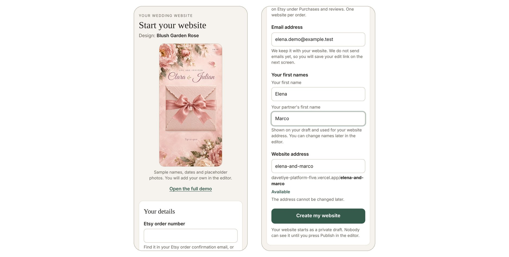
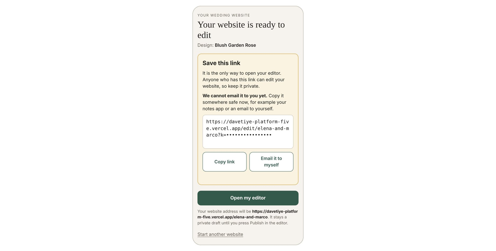
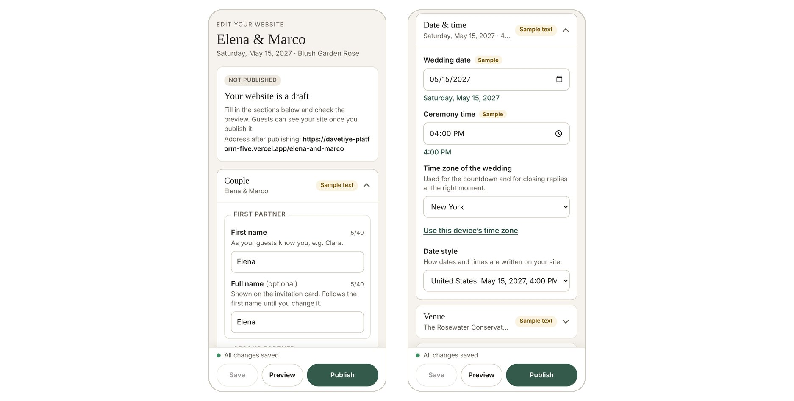
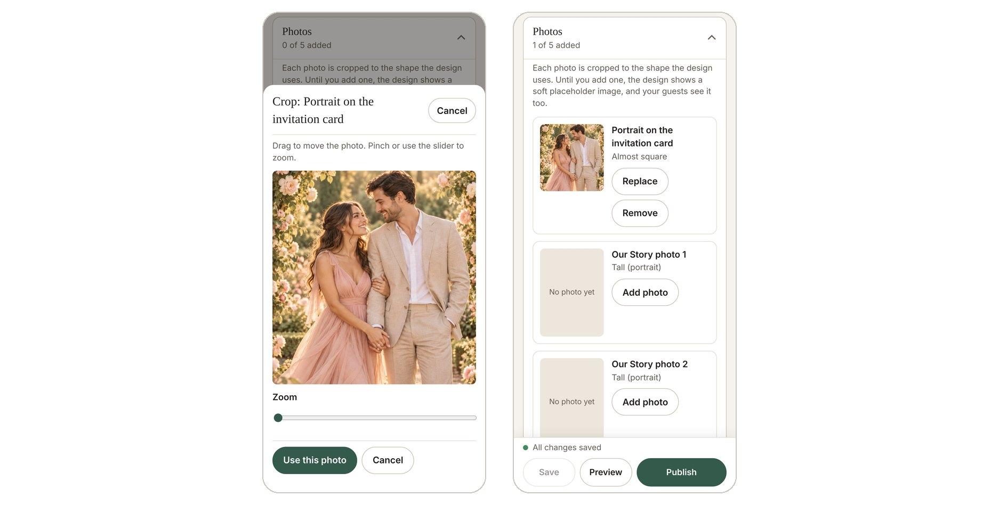
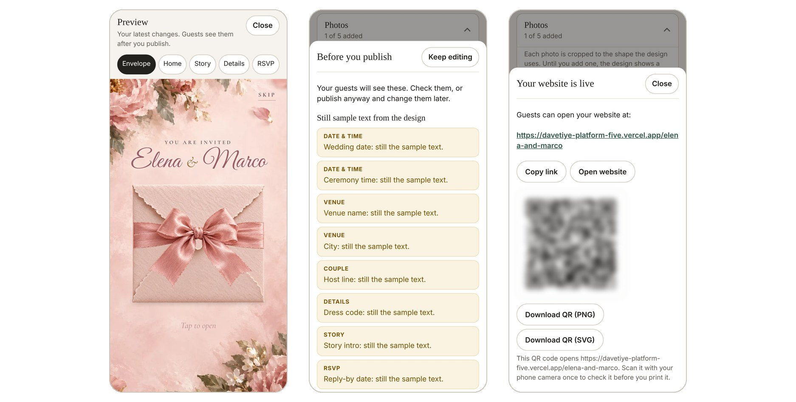
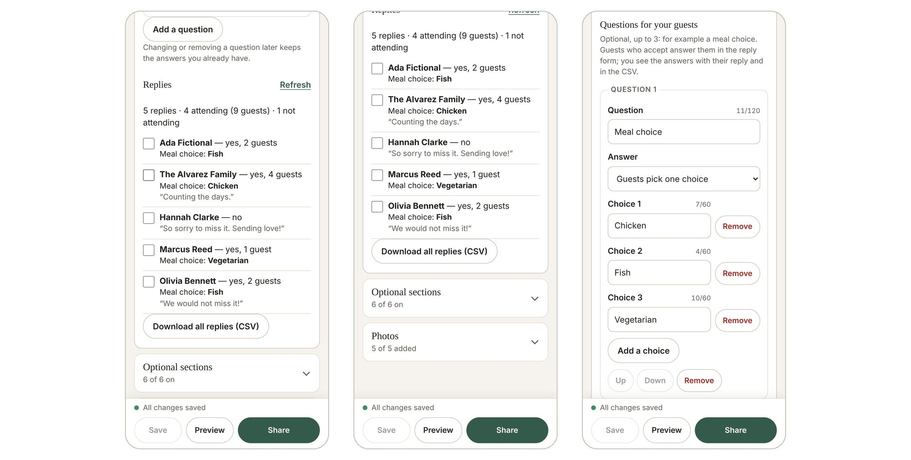
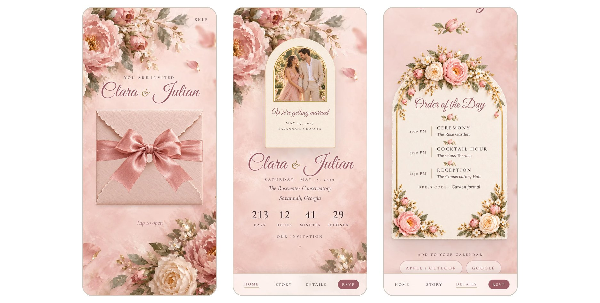

# Start Here: Your Blush Garden Rose Wedding Website

Thank you for your order from [SHOP NAME]. This guide takes you from your Etsy purchase to a published wedding website your guests can open on their phones. Keep this PDF: your start link is inside.

## Your start link

> **Open this link to start your website:**
>
> [https://davetiye-platform-five.vercel.app/start?theme=blush-garden-rose](https://davetiye-platform-five.vercel.app/start?theme=blush-garden-rose)

Or scan this code with your phone camera:

The link opens the Blush Garden Rose design. Everything happens in your web browser: the editor is made for phone screens and also works on a computer. There is nothing to install and you do not need a Canva account.

## What you need

- Your **Etsy order number**. You find it in your Etsy order confirmation email, or on Etsy under **Purchases and reviews**. Only the digits matter: "Order #1234567890" is fine.
- An **email address** (we keep it with your website).
- Your **names, wedding date, ceremony time and venue**.
- Up to **5 photos**: a portrait for the invitation card, three photos for Our Story and one of your venue. You can add them later.
- About 20 to 30 minutes. Everything saves as you go, so you can stop and come back.

## Step 1: Start your website

1. Open your start link. You see the Blush Garden Rose design with sample names (Clara & Julian) and a link to **Open the full demo**.
2. Under **Your details**, enter your **Etsy order number**, your **email address** and your **first names**.
3. Check the **Website address**. It is made from your names, for example `elena-and-marco`. You can change it now, but **not later**. If an address is taken, the page suggests another one.
4. Tap **Create my website**. Your website starts as a **private draft**: nobody can see it until you publish it.

One website can be started per order number.

## Step 2: Save your edit link

The next screen shows your **edit link**. It is the only way to open your editor, so keep it safe and private: anyone who has it can change your website.

- Tap **Copy link** and paste it somewhere safe, for example your notes app.
- Or tap **Email it to myself**: this opens your own email app with the link in a new message. Send it to yourself.
- We **cannot email the link to you yet**, so please save it now.

Then tap **Open my editor**.

## Step 3: Fill in your details

The editor is one page with sections. Tap a section to open it:

| Section | What you change |
|---|---|
| Couple | First names, full names (shown on the invitation card), "Names as shown", host line |
| Date & time | Wedding date, ceremony time, time zone, date style (United States, United Kingdom, Canada or Australia) |
| Venue | Venue name, address, city, region and country |
| Schedule | The order of the day: up to 10 events with time and place |
| Story | The intro line and a short title for each Our Story photo |
| Details | Dress code, map link, travel & stay link, registry links |
| Questions & answers | Up to 12 questions and answers for your guests |
| RSVP | Reply-by date, up to 3 questions for your guests, and your replies |
| Optional sections | Turn Our Story, Countdown, Dress code, Registry, Travel & stay and Questions & answers on or off |
| Photos | Your 5 photos |

- Values that still come from the design's sample are marked **Sample**. Replace them with your own.
- Every change **saves by itself**. The bar at the bottom says "All changes saved".
- Tap **Preview** at any time to see your website as your guests will.

## Step 4: Add your photos

1. Open **Photos** and tap **Add photo** next to a photo place.
2. Choose a photo. Drag it to move it, pinch or use the slider to zoom, then tap **Use this photo**.
3. Each photo is cropped to the shape the design uses. You can **Replace** or **Remove** it later.

Tips: JPEG and PNG photos work everywhere. iPhone HEIC photos open only in Safari; in other browsers choose a JPEG copy. Each photo can be up to 30 MB. Until you add a photo, the design shows a soft placeholder image, and your guests see it too.

## Step 5: Preview and publish

1. Tap **Preview** and look through Envelope, Home, Story, Details and RSVP. Tap **Close** to go back.
2. Tap **Publish**. If something still shows sample text or a photo place is empty, **Before you publish** lists it. Tap an item to go to it, or tap **Publish anyway** and change it later.
3. **Your website is live** shows your website address, **Copy link**, **Open website** and a QR code.

Later changes: edit as before, then tap **Publish changes**. Your guests see changes only after you publish them. **Take the website offline** hides it again (your content is kept).

## Step 6: Share it with your guests

- **Copy link** and send it by text message, WhatsApp, email or social media. Your website address looks like `https://davetiye-platform-five.vercel.app/your-names`.
- **Download QR (PNG)** or **Download QR (SVG)** to print the code on paper invitations or signs. Scan it once with your phone camera before you print.
- Your guests do not need an app or an account. They tap the envelope to open your invitation.

## Step 7: See your replies

Open **RSVP** in your editor:

- The reply count, how many guests are coming and who declined.
- Each reply with the guest's answers to your questions (for example "Meal choice: Fish").
- **Refresh** loads new replies. **Download all replies (CSV)** gives you a spreadsheet for Excel, Numbers or Google Sheets.
- To delete a spam or duplicate reply, tick it and tap **Remove selected**.
- Replies close at the **end of your reply-by date**, in your wedding's time zone.

## What your guests see

1. **The envelope**: your names on a closed envelope. A tap opens it.
2. **Home**: your portrait card, names, date, venue, a countdown, the invitation card, add-to-calendar buttons and RSVP.
3. **Our Story**: your three photos with short titles.
4. **Details**: the order of the day, dress code, venue, map, travel & stay, registry and your questions & answers.
5. **RSVP**: guests reply with their name, whether they come, how many guests and your questions.

## Questions and troubleshooting

**I lost my edit link.**
Look for the message you sent to yourself in Step 2. If you cannot find it, message [SHOP NAME] on Etsy with your order number. [LOST LINK POLICY: how and when the shop sends a new edit link]

**"A website has already been started with this order number."**
Each order starts one website. Open it with the edit link you saved. If you did not start it, message us on Etsy.

**"This start link is not valid."**
Open the start link from this PDF again, or pick your design from the list on that page.

**The website address I want is taken.**
Use the suggested address or add a word, for example `elena-and-marco-wedding`.

**My photo does not upload.**
Use a JPEG or PNG photo up to 30 MB. On iPhone, Safari can also read HEIC photos.

**My guests do not see my changes.**
Tap **Publish changes** in the editor.

**Can I change the address later?**
No. Choose it carefully in Step 1.

**Can I use my own domain (for example yournames.com)?**
Not at the moment.

**How long does my website stay online?**
[HOSTING PERIOD]

**Can I change the colours or fonts?**
No. You change all the text and photos; the painted design stays as it is.

## Help

Message [SHOP NAME] on Etsy, or write to [SUPPORT EMAIL]. We answer within [SUPPORT RESPONSE TIME].

Privacy: your guests' replies are stored with your website and are visible only in your editor. [PRIVACY NOTICE LINK]

The sample names, dates, places and photos in the design are fictional. Replace them with your own before you share your website.
